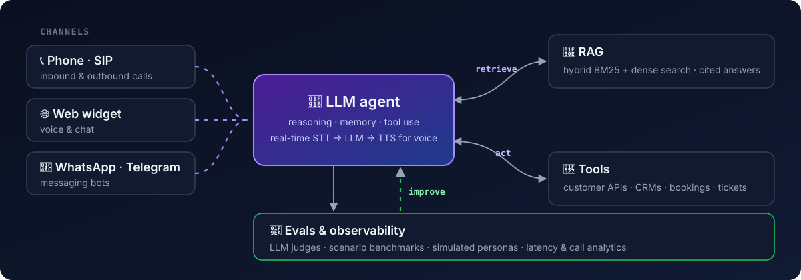

<p align="center">
  
</p>

<p align="center">
  <a href="https://git.io/typing-svg"></a>
</p>

<p align="center">
  <a href="https://linkedin.com/in/mohammedelhaj"></a>
  <a href="mailto:mohamedelhaj2000@gmail.com"></a>
  
</p>

---

### 👋 About me

```python
class MohammedElhaj:
    role       = "AI Engineer"
    builds     = ["LLM agents that take action", "RAG systems", "evals", "real-time voice AI", "document AI"]
    ships_to   = "production"
    based_in   = "Omdurman, Sudan 🇸🇩"
    languages  = {"Arabic": "native", "English": "fluent"}
    education  = "BSc Electrical & Electronic Eng., University of Khartoum — First Class Honours (2026)"

    def now(self):
        return "AI Engineer (contract) at a US healthcare-AI startup"

    def before(self):
        return {
            "Sofof Tech  (2025–26)": "led an agentic voice platform — tools, RAG, evals, SIP telephony",
            "Fatoorah.ai (2025)":    "led a multi-tenant voice-agent SaaS; built vision-LLM document extraction",
            "Freelance   (2024– )":  "RAG assistants, agents and bots for clients, first version to production",
        }
```

### ⚡ Highlights

- 🤖 **Agents that take action** — tool-calling agents wired into customers' APIs, working over phone calls (SIP inbound & outbound), web, WhatsApp and Telegram
- 🚀 **Shipped, not just prototyped** — agent platforms, a [procurement-law RAG assistant](https://muan.sa/) and document-AI systems running in production
- 🧪 **Evals first** — a DeepEval harness with LLM judges and simulated personas; post-call analytics passing 8/8 pre-set targets on a 25-scenario Arabic benchmark
- 📞 **Real-time voice** — multi-provider STT/LLM/TTS failover and speech-to-speech; we measured p50 latency falling from ~2.05 s to ~1.2 s in testing
- 🧾 **Document AI** — vision-LLM invoice extraction: **0.82 F1 vs 0.60** for Google Document AI on 42 human-labelled invoices
- 🔎 **Research** — Arabic RAG query enhancement: **+54.5% nDCG@10 over BM25** on MIRACL-Arabic (2.06M passages); paper in preparation with [@Osmanoor](https://github.com/Osmanoor)
- 👥 Mentored 5 junior AI engineers · taught a 3-session Arabic workshop on AI agents · IndabaX Sudan speakers team

---

### 🧩 How I build agents

<p align="center">
  
</p>

---

### 🛠️ Featured work

<table>
  <tr>
    <td width="50%" valign="top">
      <h4>🎤 <a href="https://github.com/mohammed-elhaj/eeexplore-voice-ai-workshop">Real-Time Voice AI Workshop</a></h4>
      Open-source Arabic course: build a voice agent that listens, thinks and speaks, then give it tools, RAG and web search. Free-tier stack so any student can follow.<br/><br/>
        
    </td>
    <td width="50%" valign="top">
      <h4>📚 <a href="https://github.com/Osmanoor/arabic-rag-query-enhancement">Arabic RAG Query Enhancement</a></h4>
      BSc thesis: sparse and dense retrievers react oppositely to LLM query expansion, so we route them asymmetrically. 10 open LLMs (2B–8B) benchmarked.<br/><br/>
        
    </td>
  </tr>
  <tr>
    <td width="50%" valign="top">
      <h4>⚖️ <a href="https://muan.sa/">Saudi Procurement-Law Assistant</a></h4>
      Bilingual RAG assistant for Saudi procurement law, live in production: answers with article-level citations, document search and a WhatsApp channel.<br/><br/>
        
    </td>
    <td width="50%" valign="top">
      <h4>🖼️ <a href="https://github.com/mohammed-elhaj/multimodal-RAG">Multimodal RAG Agent</a></h4>
      A vision LLM turns PDF pages into a structured knowledge base; answers come with the source page image as a citation.<br/><br/>
        
    </td>
  </tr>
</table>

---

---

### 🧰 Stack

<p align="center">
  
</p>

<table>
  <tr>
    <td width="20%"><b>🤖 LLMs &amp; agents</b></td>
    <td>         </td>
  </tr>
  <tr>
    <td width="20%"><b>🔎 RAG &amp; retrieval</b></td>
    <td>       </td>
  </tr>
  <tr>
    <td width="20%"><b>🧪 Evals &amp; observability</b></td>
    <td>       </td>
  </tr>
  <tr>
    <td width="20%"><b>📞 Real-time voice</b></td>
    <td>        </td>
  </tr>
  <tr>
    <td width="20%"><b>💬 Channels</b></td>
    <td>   </td>
  </tr>
  <tr>
    <td width="20%"><b>🧾 Document AI &amp; vision</b></td>
    <td>     </td>
  </tr>
  <tr>
    <td width="20%"><b>🚀 Backend &amp; production</b></td>
    <td>             </td>
  </tr>
  <tr>
    <td width="20%"><b>🔥 ML &amp; data</b></td>
    <td>   </td>
  </tr>
</table>
